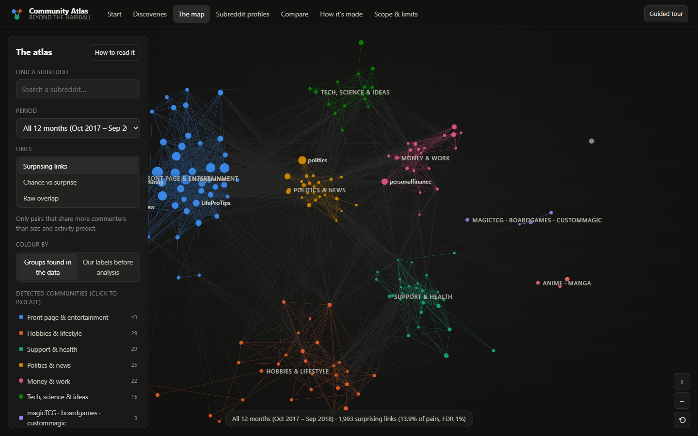

# Beyond the Hairball: The Reddit Community Atlas

**What really connects Reddit's communities?** An interactive, statistically validated map of shared audiences across
**170 subreddits** over **12 months (Oct 2017 – Sep 2018)**, built from **223,218,978** public Reddit comments
(**210,325,806** after cleaning, **2,446,462** pseudonymised commenters).

*CSE3729 Computational Social Media Analysis · BML Munjal University · 2026–27 · Akashita (230779), Vansh Jaitly (230687)*



## What it shows

Linking two subreddits whenever they share a commenter connects **99.99%** of all pairs. One person who comments
in many places links all of them, so the biggest communities look close to everything. The Atlas instead compares
each pair's shared commenters with the number expected from **community size and user activity alone** (the Bipartite
Configuration Model) and keeps only pairs that beat that expectation at a 1% false discovery rate: **13.9%** of
pairs. On that network:

| Story | Finding (descriptive, this sample only) |
|---|---|
| **What popularity hides** | Front-page hubs make up 49% of a topical subreddit's ten closest neighbours by raw overlap, but 4% after adjustment; 8 of the 10 best-connected communities by raw overlap are hubs. r/AskReddit and r/worldnews share 470,607 commenters and are never a surprising link (1.00×). |
| **Neighbours and strangers** | r/CanadaPolitics and r/PersonalFinanceCanada share 1,536 commenters where 249 were expected (≥ 7.07× in every quarter); the same money topic across the border (r/PersonalFinanceCanada – r/UKPersonalFinance) shares 0.28× of expectation. The same test finds strangers: r/linux – r/MakeupAddiction 0.042×. |
| **Connectors and sealed rooms** | r/Frugal, r/Economics and r/askscience spread their surprising links most evenly across the clusters (the hub-vs-topical gap is not statistically significant). Politics & news sends 66% of its links to other clusters, Support & health 37%; r/AskReddit keeps all 26 of its links inside its own cluster. |
| **When crowds arrive and leave** | After Bitcoin's Dec 2017 peak, crypto commenters fell steeply (r/Bitcoin -81%) while the frame grew +14%. r/Bitcoin–r/CryptoCurrency affinity went 3.37× → 9.8×, but the share of r/Bitcoin commenters also in r/CryptoCurrency moved only 24% → 28%: the expectation shrank with the communities. Crowds arriving (The Last Jedi, Infinity War) show the same arithmetic in reverse. |

Every number above is generated by `atlas/build_atlas.py` and reproduced in [`docs/FINAL_REPORT.md`](docs/FINAL_REPORT.md).

## Submission deliverables

| Deliverable | Where |
|---|---|
| Application (the Atlas) | `atlas/` · run `python atlas/serve.py` |
| Data & Pipeline Console | `streamlit run data_curation/dashboard.py` |
| Final structured report | [`docs/FINAL_REPORT.md`](docs/FINAL_REPORT.md) / `docs/FINAL_REPORT.pdf` (generated from the artifacts) |
| Presentation | `docs/presentation/Community_Atlas.pptx` (rebuild: `cd tools/deck && npm install && npm run build`) |
| Five-minute demo script | [`docs/DEMO_SCRIPT.md`](docs/DEMO_SCRIPT.md) |
| Walkthrough video | `docs/demo/atlas_walkthrough.mp4`: a silent, captioned screen walkthrough. Record a narrated live demo with the script above for the final submission. |
| Contribution matrix | [`docs/CONTRIBUTION_MATRIX.md`](docs/CONTRIBUTION_MATRIX.md): the team must confirm the Atlas-phase rows |
| Gephi / Tableau files | `atlas/web/exports/` (GEXF networks, CSV nodes and edges per period) |

## The application

`python atlas/serve.py` opens a static site (no server-side code) with seven sections and a guided tour:

| Section | What a visitor can do |
|---|---|
| **Start** | Read the question, see two real pairs, and scroll as one map turns from the raw hairball into "chance vs surprise" and then into the surprising links alone |
| **Guided tour** | A ten-step walkthrough that drives the real pages; leave it to explore and resume from the pill |
| **Discoveries** | Four stories that move the map step by step, with evidence, caveats, a takeaway and actions to check the finding yourself |
| **Atlas** | Search, periods (window / quarters / months), three line views, colour by community or category, a panel per subreddit |
| **Explore** | A profile per subreddit: surprising overlaps, raw-vs-adjusted neighbours, pairs below chance, connector role, activity over time |
| **Compare** | Two subreddits (surprising / within chance / fewer than chance, with p-values and monthly affinity) or two periods (links gained and lost against the churn baseline) |
| **How it's made** | The nine-stage pipeline with real counts, a worked example, a toy model example, the test inventory and artifact hashes |
| **Scope & limits** | Sample, cleaning, validation, project evolution, privacy, and what can and cannot be concluded |

Design decisions for this version are in [`docs/V2_DESIGN_DECISIONS.md`](docs/V2_DESIGN_DECISIONS.md).

## Quick start

```bash
pip install -r requirements.txt
```

Open the Atlas. The generated data is committed, so no Reddit data is needed:

```bash
python atlas/serve.py
```

Then visit http://127.0.0.1:8000. Run the tests (112; one needs the optional `pip install bicm==3.4.0`):

```bash
python -m pytest tests/
```

Open the Data & Pipeline Console (coverage, cleaning audit, bot review):

```bash
streamlit run data_curation/dashboard.py
```

## Reproducing the analysis from raw data

1. Provide a private salt for author hashing, either as the `BRIDGE_BROKERS_SALT` environment variable or in an untracked `data_curation/salt.local` file (gitignored). Never commit it.
2. Fetch and clean (about 30 minutes per quarter over HTTPS from the `open-index/arctic` archive):
   ```bash
   python data_curation/run_pipeline.py --start 2017 10 --end 2018 9
   ```
3. Build every Atlas artifact: networks, communities, stories, layouts, and CSV/GEXF exports (about 6–8 minutes):
   ```bash
   python atlas/build_atlas.py
   ```
4. Regenerate the report and demo script, plus screenshots:
   ```bash
   python tools/build_docs.py --pdf
   ```
   ```bash
   python tools/capture_screens.py
   ```
5. Optional checks: compare against the reference BiCM implementation, and re-audit V1's modularity:
   ```bash
   python tools/crosscheck_bicm_reference.py
   ```
   ```bash
   python tools/audit_v1_modularity.py
   ```

## Repository map

| Path | Contents |
|---|---|
| `data_curation/` | Fetch (`fetch.py`), cleaning and bot filter (`clean.py`), frame config, Streamlit console (`dashboard.py`) |
| `network_analysis/affinity.py` | **Final method**: BiCM expected overlap, affinity, Poisson test + Benjamini–Hochberg FDR |
| `network_analysis/` (other modules) | Leiden communities (now reporting weighted modularity), matching, and the V1 cosine/broker pipeline kept as the baseline |
| `atlas/build_atlas.py` | Builds all Atlas data from the cleaned Parquet |
| `atlas/web/` | The application: `index.html`, `assets/` (router, map, tour, charts, pages), bundled `vendor/` libraries, generated `data/` (including `pipeline.json`) and `exports/` |
| `atlas/validation/` | Reference cross-check results |
| `tests/` | 112 tests: cleaning, frame, communities, affinity model, published-artifact consistency and privacy |
| `docs/` | Final report (MD/HTML/PDF), demo script, contribution matrix, presentation, screenshots |
| `tools/` | Frame building, audits, cross-check, screenshot and document generators |

## Scope, validity and privacy

- **Scope.** The proposal targeted a longer window; the archive's comments end in Aug 2022, and this bounded study processed Oct 2017 – Sep 2018 for a fixed rule-based frame of 170 subreddits (150 topical + 20 front-page hubs). Results describe this sample, not Reddit.
- **Fewer than chance.** The same model also marks pairs that share *fewer* commenters than chance (lower-tail test at the same FDR, with an effect-size floor: affinity ≤ 0.5 and expected ≥ 20). Affinity is relative to an expectation that scales with community size, so the crowd discovery shows the cross-posting share beside it: r/Bitcoin–r/CryptoCurrency affinity went 3.37× → 9.8× after the exodus while the share of r/Bitcoin commenters also in r/CryptoCurrency moved only 24% → 28%.
- **Validation.** The affinity code reproduces the reference `bicm` package link-for-link on real data; a stricter activity threshold keeps 83% of links; consecutive quarters' link sets overlap at Jaccard 0.82–0.85.
- **Privacy.** Usernames are salted and hashed during collection; no comment text is stored; the Atlas publishes only subreddit-level aggregates, and a test checks this. Bot-review files (hashed account IDs) are gitignored. A copy of one such file from a prototype run exists in early git history; purging it from the remote is recommended.
- **History.** The original bridge-persistence pipeline (V1) is preserved at tag `v1-baseline`. Its cosine network was 99.85% dense and its reported modularity was unweighted (see `data_curation/data/logs/v1_modularity_audit.json`). The final report explains how the project evolved from V1.
