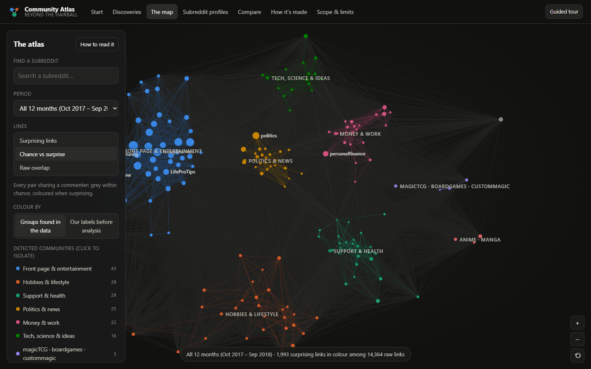
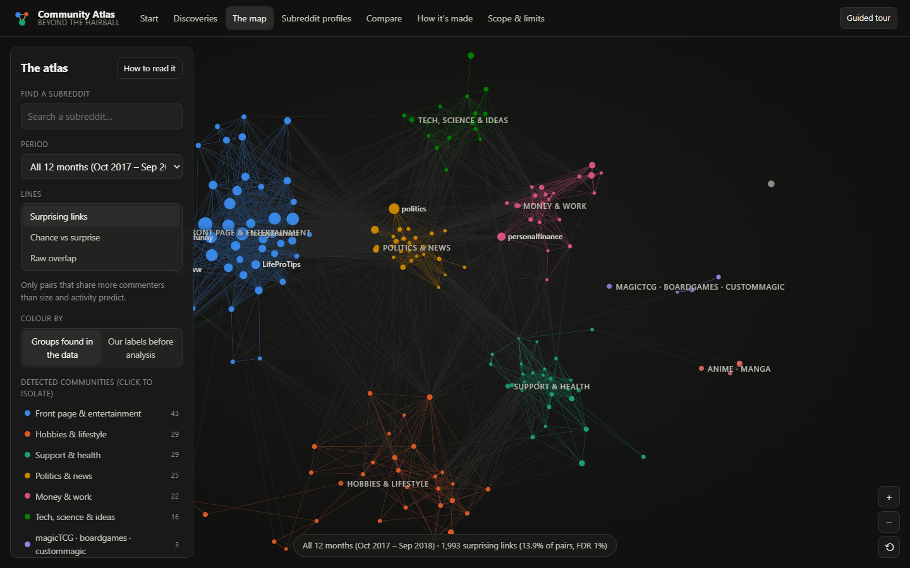
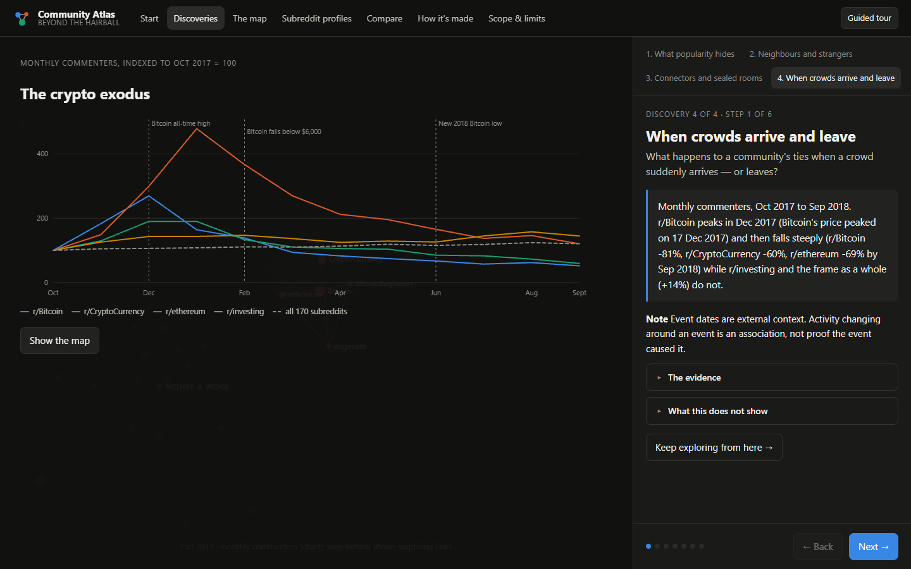
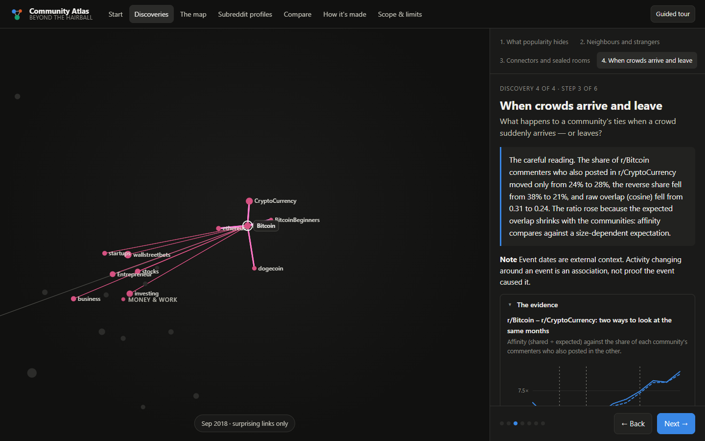
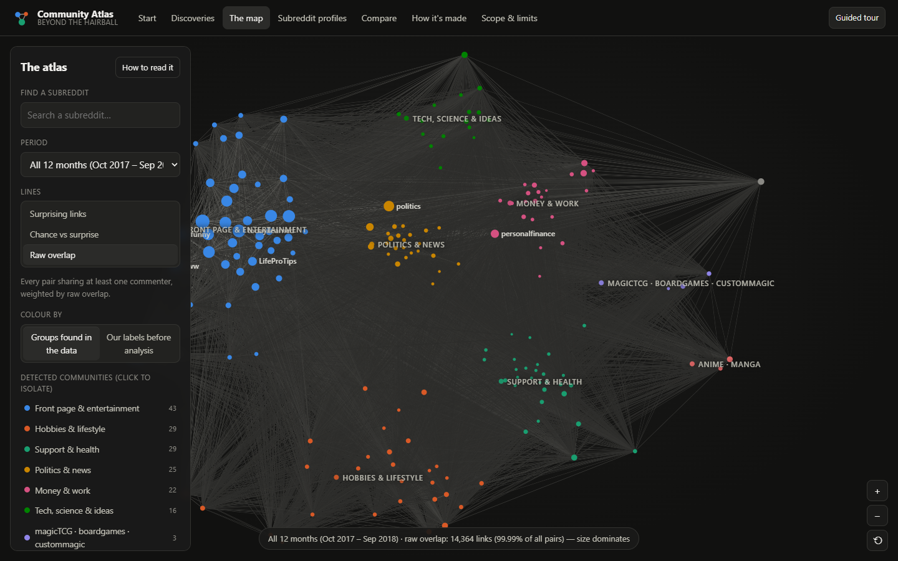
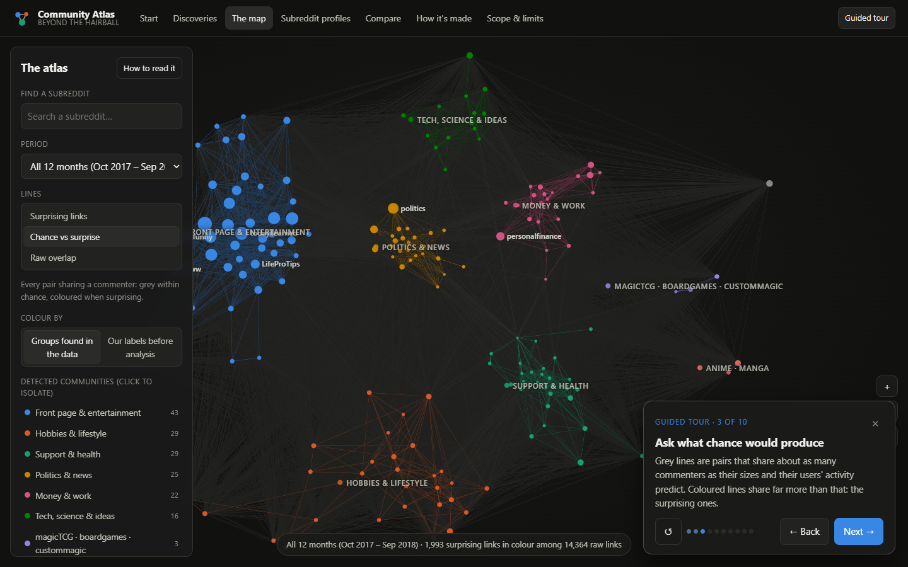
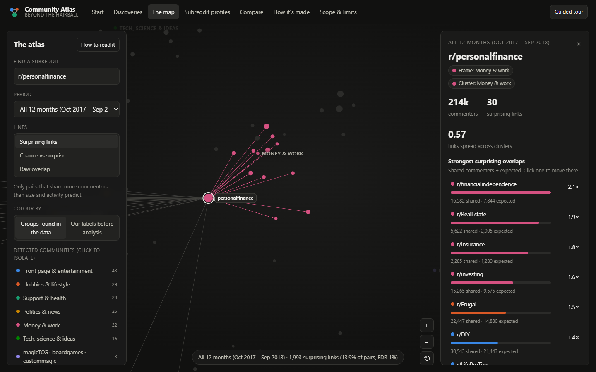
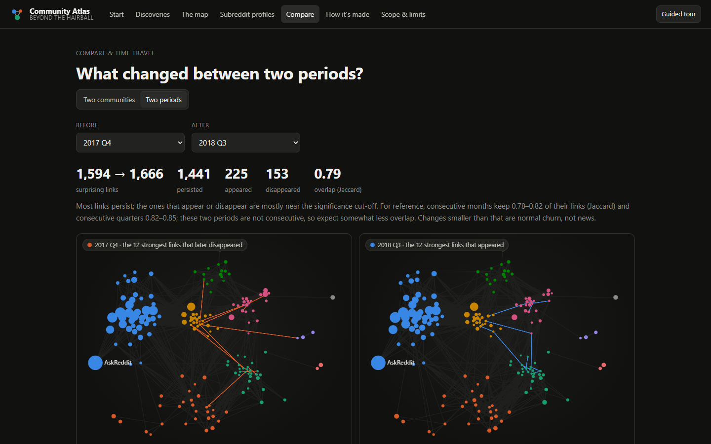

# Beyond the Hairball: The Reddit Community Atlas

**What really connects Reddit's communities? An interactive, statistically validated map of shared audiences across 170 subreddits (Oct 2017 – Sep 2018)**

CSE3729 Computational Social Media Analysis · BML Munjal University · Academic year 2026–27

Team: Akashita (230779), Vansh Jaitly (230687) · see `docs/CONTRIBUTION_MATRIX.md`

*Every number in this report is generated from the project's build artifacts by `tools/build_docs.py`; Appendix A maps each headline figure to the file it comes from.*

---

## Abstract

Online communities are often mapped through the audiences they share, but raw shared-audience networks mostly measure size: one person who comments in many places links all of them, and the biggest communities look close to everything. We collected 223,218,978 public Reddit comments from a fixed, rule-based frame of 170 subreddits over 12 months (Oct 2017 – Sep 2018), cleaned them to 210,325,806 comments by 2,446,462 pseudonymised commenters, and built a user × subreddit network. The conventional cosine projection links 99.99% of all subreddit pairs. Comparing each pair's shared commenters with the number expected from community size and user activity alone (the Bipartite Configuration Model, BiCM) and keeping only pairs that exceed it at a 1% false discovery rate leaves 13.9% of pairs. That network has a clear, reproducible structure: 6 major communities (plus 2 small groups and 1 isolate) (weighted modularity 0.577, seed agreement ARI 0.995), stable connector roles, and a Jaccard overlap of 0.82–0.85 between consecutive quarters' link sets (about 90% of a quarter's links recur). We built the results into an interactive web application, the Community Atlas, with four guided discoveries: what popularity hides, neighbours and strangers (the same test also marks pairs that share *fewer* commenters than chance), connectors and sealed clusters, and what changes — and what only appears to — when crowds arrive and leave. The project started as a test of whether cross-community "bridge positions" outlast their occupants. It evolved after the first, cosine-based pipeline proved too dense to measure bridges at all. The findings are descriptive and specific to this sample.

---

## 1. Introduction and research questions

Reddit is organised into hundreds of thousands of topical communities. Which of them share an audience, and why, is a basic question about how online attention is organised. It matters for information spread, community moderation and for any study that treats subreddits as separate populations. The usual way to answer it is a bipartite network of users and communities, *projected* onto the communities: two subreddits are linked when people comment in both.

The project began with a narrower, longitudinal question (the **submitted proposal**): *do cross-community bridge positions persist across quarters even when the people occupying them change?* Our first full pipeline (V1, §7) built that analysis on a cosine-similarity projection. On real data, the projection connected 99.85% of subreddit pairs. It produced only four communities and so only six possible bridge positions, all saturated. The bridge question could not be answered with that measurement lens. The final project therefore asks three questions that the data can support, and keeps the bridge idea as a measured connector role:

- **RQ1 (representation).** How much of the audience overlap between subreddits is explained by community size and user activity alone?
- **RQ2 (structure).** Which communities share *surprisingly* large audiences, and what communities and connectors do those relationships form?
- **RQ3 (change).** How stable are these relationships over time, and how do they respond when a crowd suddenly arrives or leaves?

The deliverable is an end-to-end, reproducible pipeline and an interactive application (the **Community Atlas**) through which an evaluator can explore the evidence.

---

## 2. Literature review

**Projections are dense by construction.** A one-mode projection of a bipartite network is a union of cliques: every user active in *k* communities adds a link between all *k* of them, and high-degree nodes share neighbours by chance (Saracco et al., 2017; Larremore et al., 2014). The same mechanism explains our 99.9%-dense V1 network. Olson and Neal (2015) met it on Reddit itself and extracted a subreddit "backbone" with the disparity filter of Serrano et al. (2009). That filter compares each edge with a per-node uniform null and ignores the bipartite origin of the weights. Coscia and Rossi (2019, preprint) show that the choice of projection and backbone changes substantive conclusions.

**Validating projections against a null model.** The Bipartite Configuration Model (Saracco et al., 2015) is a maximum-entropy random network that preserves, on average, every node's degree on both sides: here, each user's number of subreddits and each subreddit's number of commenters. Under it, the number of users shared by two communities follows a Poisson-binomial distribution, so each pair can be tested and the tests corrected for multiplicity with the Benjamini–Hochberg false discovery rate (Saracco et al., 2017). Neal, Domagalski and Sagan (2021) compare alternatives to the exact fixed-degree model and recommend this "stochastic degree sequence" approach with BiCM probabilities when exact sampling is impractical, as it is for 2,446,462 users. Cimini et al. (2022) show that different null models disagree at a fixed p-value but agree at matched density. This is why we report densities and run a sensitivity check rather than trusting one threshold. Applications to social media include validated projections of Twitter user networks (Becatti et al., 2019; Caldarelli et al., 2020). Waller and Anderson (2021) make the same conceptual move for Reddit at scale: communities are related when their user bases are "surprisingly similar" beyond chance.

**Communities, roles and time.** We detect communities with Leiden (Traag, Waltman & van Eck, 2019), which guarantees connected communities. Good, de Montjoye and Clauset (2010) show that modularity has many near-optimal partitions, so we report seed agreement and sensitivity rather than a single partition. A subreddit's connector role is measured with the participation coefficient of Guimerà and Amaral (2005). Communities and links are compared across time by Jaccard matching (Greene, Doyle & Cunningham, 2010). Text-free event studies of Reddit measure active users and newcomers around documented dates and mask archive outages (Horta Ribeiro et al., 2021). Crypto-community activity co-moves with prices during bubbles, without implying causation (Phillips & Gorse, 2018).

**Visualisation and storytelling.** The Atlas follows Shneiderman's (1996) "overview first, zoom and filter, details on demand". Its stories use the "martini glass" structure of Segel and Heer (2010): a short author-driven sequence that opens into free exploration. Node-link diagrams of dense graphs are hard to read (Ghoniem, Fekete & Castagliola, 2005), which is one more reason to show the validated network. Following Archambault, Purchase and Pinaud (2011), time comparisons are shown side by side by default. The force-directed layout is treated as an approximation in which distance is not literal (Jacomy et al., 2014).

**Data quality and ethics.** Pushshift-derived archives, which the Arctic Shift data repackages (Baumgartner et al., 2020), have bursty missing data; network analyses of such data are among the most exposed to it (Gaffney & Matias, 2018). Social-media samples are not populations, and platform design shapes what can be measured (Ruths & Pfeffer, 2014). Reddit research ethics stresses aggregation and care with sensitive communities (Proferes et al., 2021).

**Evidence matrix (selected sources).**

| Source | Contribution | Decision it informs |
|---|---|---|
| Saracco et al. (2015, 2017) | BiCM; Poisson-binomial test of shared neighbours with FDR | The edge definition |
| Neal et al. (2021); Cimini et al. (2022) | Comparison of null models; agreement at matched density | BiCM over exact sampling; report density and sensitivity |
| Larremore et al. (2014) | Projections lose information; bipartite SBM | Rejected direct SBM on 2,446,462 users as disproportionate |
| Serrano et al. (2009); Olson & Neal (2015) | Disparity-filter backbones, including on Reddit | V1 display baseline; Reddit precedent |
| Waller & Anderson (2021) | Reddit communities related by beyond-chance overlap | Supports observed ÷ expected |
| Traag et al. (2019); Good et al. (2010) | Leiden; degeneracy of modularity | Leiden, seed and sensitivity reporting |
| Guimerà & Amaral (2005) | Participation coefficient | Connector score |
| Greene et al. (2010) | Jaccard matching across snapshots | Link and community persistence |
| Shneiderman (1996); Segel & Heer (2010) | Overview → details; martini-glass stories | App structure and story mode |
| Archambault et al. (2011); Jacomy et al. (2014); Ghoniem et al. (2005) | Small multiples; layout caveats; dense-graph readability | Side-by-side periods; layout caption; no hairball as primary map |
| Gaffney & Matias (2018); Baumgartner et al. (2020) | Missing data in Pushshift-derived corpora; provenance | Counts as lower bounds; provenance statement |
| Horta Ribeiro et al. (2021); Phillips & Gorse (2018) | Text-free event metrics; crypto activity co-moves with price | Story D metrics and wording |
| Ruths & Pfeffer (2014); Proferes et al. (2021) | Population bias; Reddit research ethics | Scope wording; aggregate-only publication |

---

## 3. Data

**Source.** Public Reddit comments from the Arctic Shift archive, a re-packaging of Pushshift dumps hosted on Hugging Face (`open-index/arctic`), read remotely with DuckDB. Comments in this archive end in August 2022.

**Sampling frame.** 170 subreddits chosen by a fixed rule before any analysis: 25 in each of six topical categories (politics & news, hobby, support, finance, expertise, media) plus 20 front-page "gateway" hubs, each with at least 2,000 comments in every one of three calibration months (`frame.csv`, `FRAME_JUSTIFICATION.md`).

**Scope versus proposal.** The proposal planned roughly 150 subreddits over 2019–2025; verification showed comments are only available up to 2022-08, and the window was revised to 2018–2022. This bounded first study processed **12 months, Oct 2017 – Sep 2018 (2017 Q4, 2018 Q1, 2018 Q2, 2018 Q3)**. 2017 Q4 was added to the original three 2018 quarters so the window contains the December 2017 Bitcoin peak. The later years were not collected. All findings describe this sample and window, not Reddit as a whole.

**Collection and cleaning.** Usernames are replaced in the query by a salted SHA-256 hash; no text is kept, only author hash, subreddit, timestamp and a moderator flag. Every fetch asserts that all 170 subreddits are present (coverage: 2017 Q4 complete, 2018 Q1 complete, 2018 Q2 complete, 2018 Q3 complete). Cleaning keeps accounts with at least five comments in a quarter and removes accounts that are both very high-volume (≥ 2,000 comments) and active in at least half the frame (bots).

| Quarter | Raw comments | Retained | % kept | Commenters (raw → kept) | Bot accounts removed |
|---|---:|---:|---:|---|---:|
| 2017 Q4 | 51,616,108 | 48,633,963 | 94.2% | 2,763,494 → 1,144,505 | 5 |
| 2018 Q1 | 55,248,128 | 52,118,250 | 94.3% | 2,919,421 → 1,215,022 | 5 |
| 2018 Q2 | 57,301,138 | 54,002,756 | 94.2% | 3,069,238 → 1,279,269 | 5 |
| 2018 Q3 | 59,053,604 | 55,570,837 | 94.1% | 3,248,860 → 1,339,394 | 0 |
| **Total** | **223,218,978** | **210,325,806** | **94.22%** | 2,446,462 distinct kept | 15 |

---

## 4. Methods

1. **Bipartite matrix.** For any period (the whole window, a quarter or a month), a binary matrix records which users commented in which subreddits. Duplicate records are collapsed; this matters, because unsummed duplicates inflate user degrees and break the model.
2. **Raw overlap (baseline).** Cosine similarity of commenter sets, as in V1.
3. **Expected overlap.** The BiCM probability *p(u, s)* that user *u* comments in subreddit *s*, fitted so every user keeps their number of subreddits and every subreddit its number of commenters (on average). Users with the same degree share parameters, so the fit has at most a few hundred unknowns. Expected shared commenters: *E(a, b) = Σ_u p(u, a) · p(u, b)*. **Affinity** = observed shared commenters ÷ *E(a, b)*.
4. **Validated ("surprising") links.** One-sided Poisson test of the observed count against *E(a, b)*, the reference implementation's default approximation, with Benjamini–Hochberg FDR at 1% over all 14,365 pairs. The lower tail is tested the same way: a pair is marked as sharing *fewer* commenters than chance when its lower-tail test passes the same FDR and, as an effect-size floor, it shares at most half of its expected overlap with at least 20 expected (the "avoided" rule).
5. **Communities and roles.** Leiden (RBConfiguration, γ = 1) on log-affinity weights, best of 20 seeds, on the network pooled over all months. The resulting anchor partition gives stable colours across periods. Participation coefficient and within-community degree (Guimerà & Amaral, 2005) measure connector roles per quarter.
6. **Change over time.** Jaccard overlap of validated link sets between consecutive months and quarters, used as the "normal churn" baseline. Monthly affinity series for chosen pairs, weekly commenter counts and the share of newcomers.
7. **Validation.** (a) Unit tests: degree constraints, duplicates, empty communities, structureless data producing no false links, pure popularity producing no hub links, planted communities recovered. (b) Equivalence with the reference `bicm` package on real data. (c) Exact Poisson-binomial check near the cut-off. (d) A stricter threshold counting only users with ≥ 2 comments in a subreddit. (e) Artifact tests that recompute every story number from the published files.

**Validation results.** On a 150,000-user sample of 2018 Q1, our implementation and `bicm` v3.4.0 validate the identical set of 952 links (overlap 1.000); fitted probabilities differ by at most 1.1e-08. Exact Poisson-binomial p-values for the 300 pairs nearest the threshold would add 22 links and remove 0 (2.3% of validated links), so the approximation is slightly conservative. Under the stricter threshold, 83% of the whole-window links remain (quarters: 74%, 74%, 77%, 77%), and community assignments agree at ARI 0.933. Of the 112 automated tests, 111 run in the standard environment and pass; the remaining one compares directly against the optional `bicm` package and passes when it is installed.

---

## 5. Results

Each result is reported as **observed → how measured → what it means → what we cannot conclude**.

### 5.1 What popularity hides (RQ1)

- **Observed.** Raw overlap links 99.99% of pairs over the whole window (99.91%, 99.85%, 99.93%, 99.86% per quarter). 8 of the ten communities with the largest total raw overlap are front-page hubs, and all ten sit in the front-page cluster (r/todayilearned, r/pics, r/AskReddit, r/news, r/worldnews, …). Among the ten closest neighbours of each topical subreddit, hubs make up **49%** by raw overlap but **4%** by affinity. Neighbours from the subreddit's own topical category rise from 36% to 66%. The validated network keeps 13.9% of pairs over the whole window, 11.1%, 11.4%, 11.5%, 11.6% per quarter and 7.2%–8.8% per month.
- **Example.** r/personalfinance's closest raw neighbours are r/news, r/LifeProTips (hub), r/AskReddit (hub), r/pics (hub), r/todayilearned (hub). Its strongest surprising overlaps are r/financialindependence (2.11×), r/RealEstate (1.94×), r/Insurance (1.78×), r/investing (1.59×), r/Frugal (1.51×). r/AskReddit and r/worldnews share 470,607 commenters, the largest shared audience of any pair that is never a surprising link, where 472,898 were expected (1.00×): in none of the 17 periods tested is it a surprising link. r/AskReddit (1,526,775 commenters, 62% of everyone in the frame) has a median affinity of 0.80× and falls short of expectation with 143 of the other 169 communities; for a community that large the expected overlap is close to the maximum possible, so its affinity is bounded near 1.2× by construction. For 36 of 170 subreddits (for example r/3Dprinting, r/ADHD, r/bicycling) the five closest neighbours by raw overlap and by affinity share no name at all.
- **Meaning.** Most of what a raw shared-audience map shows is community size. Controlling for size and user activity recovers topical relationships.
- **Cannot conclude.** Affinity measures co-commenting, not friendship, conversation or influence.




### 5.2 Communities and connectors (RQ2)

The validated network pooled over all months has **6 major communities (plus 2 small groups and 1 isolate)**: weighted modularity 0.577, mean agreement between 20 Leiden seeds ARI 0.995. The communities found in each quarter agree with this anchor partition at ARI 0.887, 0.854, 0.933, 0.903. They partly follow the frame categories (ARI 0.481), with informative exceptions: r/Economics sits with politics, and media subreddits split between the front-page cluster and hobbies.

| Community (auto-labelled) | Subreddits | Largest members | Category mix |
|---|---:|---|---|
| Front page & entertainment | 43 | r/AskReddit, r/funny, r/pics, r/todayilearned, r/worldnews | front 19, media 15, tech 4, hobbies 3, politics 2 |
| Hobbies & lifestyle | 29 | r/hiphopheads, r/Fitness, r/Frugal, r/cats, r/gardening | hobbies 17, media 7, tech 2, support 2, money 1 |
| Support & health | 29 | r/relationship_advice, r/depression, r/offmychest, r/Parenting, r/Anxiety | support 23, tech 3, media 1, politics 1, money 1 |
| Politics & news | 25 | r/politics, r/PoliticalHumor, r/conspiracy, r/Libertarian, r/changemyview | politics 21, tech 2, money 2 |
| Money & work | 22 | r/personalfinance, r/Bitcoin, r/CryptoCurrency, r/wallstreetbets, r/investing | money 21, politics 1 |
| Tech, science & ideas | 16 | r/buildapc, r/programming, r/sysadmin, r/learnprogramming, r/linux | tech 14, hobbies 2 |
| magicTCG · boardgames · custommagic | 3 | r/magicTCG, r/boardgames, r/custommagic | hobbies 3 |
| anime · manga | 2 | r/anime, r/manga | media 2 |
| RoastMe | 1 | r/RoastMe | front 1 |

**Connectors.** The participation coefficient is 0 when all of a subreddit's surprising links stay inside its own community and approaches 1 when they spread evenly across communities. Among subreddits with at least 8 links, the highest scores in every quarter belong to mid-sized topical communities, with one front-page hub among them (r/NoStupidQuestions):

| Subreddit | Frame category | Clusters reached | Participation (min over quarters) |
|---|---|---:|---:|
| r/Frugal | Money & work | 5 | 0.65 |
| r/Economics | Money & work | 6 | 0.63 |
| r/askscience | Tech, science & ideas | 5 | 0.60 |
| r/business | Money & work | 6 | 0.59 |
| r/woodworking | Hobbies & lifestyle | 4 | 0.58 |
| r/NoStupidQuestions | Front page & entertainment | 4 | 0.57 |
| r/childfree | Support & health | 3 | 0.56 |
| r/askphilosophy | Tech, science & ideas | 4 | 0.55 |

Front-page hubs average 0.25, topical communities 0.31; the difference between hub and topical mean participation is not statistically significant (permutation p ≈ 0.3) and is not claimed. Connector rankings are stable between quarters (Spearman ρ 0.87, 0.90, 0.94).

**Sealed and porous clusters.** The share of a cluster's surprising links that leave it, compared with what a random rewiring that keeps every subreddit's number of links would give:

| Cluster | Subreddits | Links inside / outward | Share leaving | vs degree-preserving rewiring |
|---|---:|---|---:|---:|
| Politics & news | 25 | 235 / 449 | 66% | 0.85× |
| Front page & entertainment | 43 | 564 / 407 | 42% | 0.68× |
| Tech, science & ideas | 16 | 69 / 119 | 63% | 0.68× |
| Hobbies & lifestyle | 29 | 111 / 137 | 55% | 0.61× |
| Money & work | 22 | 133 / 154 | 54% | 0.60× |
| Support & health | 29 | 187 / 110 | 37% | 0.42× |

r/AskReddit is the opposite of a connector: all 26 of its surprising links lie inside the Front page & entertainment cluster; it is above expectation with 26 of the other 42 members of that cluster and below expectation with 127 of the 127 communities outside it. Part of this is arithmetic: holding 62% of all commenters, it cannot share much more than chance with anyone.

*Cannot conclude:* a connector shares unusually many commenters with several clusters; that is not evidence that information flows through it. The participation coefficient depends on the partition.

### 5.3 Neighbours and strangers (RQ2)

**218 links** join subreddits from different frame categories, excluding hubs, and are significant in every quarter under both thresholds. The strongest:

| Pair | Categories | Shared (all months) | Expected | Minimum affinity in any quarter |
|---|---|---:|---:|---:|
| r/CanadaPolitics – r/PersonalFinanceCanada | Politics & news × Money & work | 1,536 | 249 | 7.07× |
| r/UKPersonalFinance – r/ukpolitics | Money & work × Politics & news | 2,015 | 359 | 6.54× |
| r/Economics – r/geopolitics | Money & work × Politics & news | 1,393 | 281 | 5.26× |
| r/startups – r/webdev | Money & work × Tech, science & ideas | 1,291 | 303 | 5.02× |
| r/askphilosophy – r/CapitalismVSocialism | Tech, science & ideas × Politics & news | 320 | 72 | 4.80× |
| r/CapitalismVSocialism – r/Economics | Politics & news × Money & work | 833 | 211 | 4.50× |
| r/Economics – r/PoliticalDiscussion | Money & work × Politics & news | 2,257 | 565 | 4.46× |
| r/audioengineering – r/Guitar | Tech, science & ideas × Hobbies & lifestyle | 1,639 | 411 | 4.41× |

The two strongest pair a country's politics forum with the same country's personal-finance forum, which is consistent with shared nationality rather than topic organising these audiences. The control makes the point: the same personal-finance topic across the border (r/PersonalFinanceCanada – r/UKPersonalFinance) shares 58 commenters where 205 were expected (0.28×), fewer than chance in every quarter, and the national forums' ties to the US-default r/politics and r/personalfinance are modest by comparison (r/CanadaPolitics – r/politics 1.19× (surprising but small); r/PersonalFinanceCanada – r/personalfinance 0.96× (within chance); r/ukpolitics – r/politics 0.98× (within chance); r/UKPersonalFinance – r/personalfinance 0.71× (below expectation)). Only two same-country pairs exist in the frame, so this is consistent with these cases, not a general law.

| Pair | Relation | Shared | Expected | Affinity | Status |
|---|---|---:|---:|---:|---|
| r/CanadaPolitics – r/PersonalFinanceCanada | same country, different topic | 1,536 | 249 | 6.16× | surprising (17 of 17 periods significant) |
| r/ukpolitics – r/UKPersonalFinance | same country, different topic | 2,015 | 359 | 5.61× | surprising (17 of 17 periods significant) |
| r/PersonalFinanceCanada – r/UKPersonalFinance | same topic, across the border (control) | 58 | 205 | 0.28× | fewer than chance (0 of 17 periods significant) |
| r/CanadaPolitics – r/ukpolitics | same topic, across the border (control) | 506 | 438 | 1.16× | surprising (1 of 17 periods significant) |
| r/CanadaPolitics – r/politics | national forum vs the US-default forum | 4,897 | 4,117 | 1.19× | surprising (11 of 17 periods significant) |
| r/PersonalFinanceCanada – r/personalfinance | national forum vs the US-default forum | 3,690 | 3,846 | 0.96× | within chance (2 of 17 periods significant) |
| r/ukpolitics – r/politics | national forum vs the US-default forum | 11,018 | 11,273 | 0.98× | within chance (0 of 17 periods significant) |
| r/UKPersonalFinance – r/personalfinance | national forum vs the US-default forum | 1,479 | 2,077 | 0.71× | within chance (0 of 17 periods significant) |

Links that also cross the detected communities include r/CanadaPolitics – r/PersonalFinanceCanada (≥ 7.07×), r/startups – r/webdev (≥ 5.02×), r/business – r/inthenews (≥ 2.96×), r/nutrition – r/selfimprovement (≥ 2.87×), r/Entrepreneur – r/webdev (≥ 2.79×), r/ChronicPain – r/crochet (≥ 2.71×). **Audiences that keep apart.** The same test in the other direction finds strangers: 4,673 pairs share fewer commenters than chance under the avoided rule (lower-tail FDR 1%, affinity ≤ 0.5, expected ≥ 20). The widest gulfs are not political. The five beauty, fashion and fibre-craft communities (r/MakeupAddiction, r/SkincareAddiction, r/femalefashionadvice, r/crochet, r/knitting) share 0.18× of the expected overlap with the tech, science & ideas cluster and 0.33× with the money & work cluster, in every quarter. Some communities keep apart from almost everyone: r/manga shares fewer commenters than chance with 144 of 169 (the median community: 48.5).

| Pair | Shared | Expected | Affinity | Quarters below half of expectation |
|---|---:|---:|---:|---:|
| r/linux – r/MakeupAddiction | 59 | 1,415 | 0.042× | 4 of 4 |
| r/hardware – r/MakeupAddiction | 34 | 752 | 0.045× | 4 of 4 |
| r/ethereum – r/MakeupAddiction | 71 | 1,298 | 0.055× | 4 of 4 |
| r/CryptoCurrency – r/MakeupAddiction | 290 | 5,073 | 0.057× | 4 of 4 |
| r/MakeupAddiction – r/sysadmin | 118 | 2,004 | 0.059× | 4 of 4 |
| r/MakeupAddiction – r/rust | 16 | 239 | 0.067× | 4 of 4 |

**Political opponents are not strangers.** None of the 21 pairs among r/Conservative, r/Libertarian, r/socialism, r/Anarchism, r/democrats, r/neoliberal, r/CapitalismVSocialism shares fewer commenters than chance; 21 of 21 share more (weakest r/Conservative – r/Anarchism at 1.49×, median 3.25×).

*Cannot conclude:* why audiences overlap or keep apart. Shared geography, profession or demographics are all possible, and without text we cannot tell them apart.

### 5.4 Stability, and what crowds change (RQ3)

**Stability.** Consecutive quarters share 0.83, 0.82, 0.85 of their validated links (Jaccard); consecutive months share 0.78–0.82. Change smaller than that is normal churn.

**The crypto exodus: the trace in the counts.** r/Bitcoin's monthly commenters peak in Dec 2017, the month Bitcoin's price peaked (17 Dec 2017); r/CryptoCurrency peaks a month later (Jan 2018). From Dec 2017 to Sep 2018, r/Bitcoin -81%, r/CryptoCurrency -60%, r/ethereum -69%, r/dogecoin -68%, r/BitcoinBeginners -88%, while r/investing changed +1% and the whole frame +14%.

**The obvious reading, and the careful one.** r/Bitcoin–r/CryptoCurrency affinity was 3.37× at the peak and **9.8×** by Sep 2018 (9.48× under the stricter threshold), which reads as if the people who stayed were far more tightly bound. The behavioural check says otherwise: the share of r/Bitcoin commenters who also posted in r/CryptoCurrency moved only from 24% to 28%, the reverse share fell from 38% to 21%, and raw overlap (cosine) fell from 0.31 to 0.24. The ratio rose because the expected overlap shrinks with the communities: affinity compares observed overlap with a size-dependent expectation, so when two communities lose most of their commenters the same cross-posting behaviour produces a much larger ratio.

**A crowd arriving: The Last Jedi.** In Dec 2017 (US release 2017-12-15) r/StarWars had 63,465 commenters, 2.97× November, and 70% of them had not commented there earlier in the window. Its affinity with every fandom neighbour dipped that month (r/lego 2.33× → 1.58×, r/comics 1.31× → 1.01×, r/harrypotter 1.51× → 1.19×) and recovered in January: the same arithmetic in reverse.

**The Infinity War crowd.** *Avengers: Infinity War* opened in the US on 27 April 2018. r/marvelstudios went from a March median of 12,229 weekly commenters to 24,196 in the release week. r/marvelstudios–r/Marvel affinity fell from 7.42× in January 2018 to 3.94× in April and recovered to 5.34× by Sep 2018, while the share of r/marvelstudios commenters also active in r/Marvel rose from 10% to 13%: both communities grew, the expected overlap grew faster, and the ratio fell although cross-posting did not.

**General tendency.** Across the 96 communities with at least five stable, well-measured ties (859 ties), faster growth over the year went with a downward drift in affinity (Spearman ρ = -0.52) while raw overlap drifted up with growth (ρ = 0.79). Most of the "change" in affinity around a crowd is the expectation moving with size, not people changing where they comment.

- **Meaning.** Crowds leave a clear trace in the counts, and the share of commenters who cross between related communities is the right behavioural check. A changed affinity is not by itself a changed behaviour; the Atlas therefore shows the cross-posting share next to affinity in the crowd discovery.
- **Cannot conclude.** That the price crash or the films *caused* these changes. Event dates are external context and the patterns are temporal associations.




---

## 6. The application: the Community Atlas

The Atlas is a static web application (HTML/JavaScript with sigma.js, all libraries bundled) that reads only the aggregate JSON produced by `atlas/build_atlas.py`; nothing runs on a server, and the application says so. Every view is addressable by URL, so a view can be shared or cited. It is organised so that a visitor moves through four stages — discover, explore, understand, verify — without needing this report:

- **Start:** a scroll-driven opening that poses the question with two real pairs (one large but ordinary, one small but surprising) and then transforms one map in three steps: every pair sharing a commenter, the same map with pairs within chance greyed out, and the surprising links alone. The legend states what circle size, lines, colour and distance mean.
- **Guided tour:** a ten-step overlay that drives the real pages (map views, a profile, two discoveries, the technical walkthrough, the limits). It can be paused by navigating elsewhere and resumed from where it was left.
- **Discoveries:** four guided stories. Each step moves the map and highlights the relevant subreddits; the evidence and the caveats sit beside it; a closing step states the takeaway and offers actions to investigate the finding independently (compare the pair, open the profile, change the period).
- **Atlas:** search; period selector (whole window, quarters, months); three line views (surprising only, chance vs surprise, raw overlap); colour by detected community or frame category; community isolation; hover details; a panel for the selected subreddit with its strongest overlaps (observed vs expected), the pairs it shares *fewer* commenters with than chance, and what raw overlap would have shown; "back to overview".
- **Explore:** a profile for any subreddit: ranked surprising overlaps, raw-vs-adjusted neighbours, pairs below chance, connector role by quarter, weekly commenters and monthly affinity with its strongest neighbours.
- **Compare:** two subreddits (a three-way verdict — surprising, within chance, fewer than chance — with p-values, monthly affinity, per-quarter table, shared neighbours), or two periods (side-by-side maps with links that appeared and disappeared, against the churn baseline).
- **How it's made:** a nine-stage technical walkthrough fed by `pipeline.json`: input, transformation, output, purpose, a real example, the tests that guard the stage and what would go wrong without it. It includes the breadth histogram behind the hairball, a worked example of two real pairs with the breadth of their shared commenters, a toy BiCM example run through the real model, the test inventory, and artifact sizes and hashes. Badges separate what is precomputed, computed in the browser, and historical (V1).
- **Scope & limits:** sample and window, cleaning, validation, how the project evolved, the label the network corrected, privacy, and what can and cannot be concluded.

The existing Streamlit dashboard remains as the **Data & Pipeline Console** (coverage, cleaning audit, bot review). Design decisions are recorded in `docs/V2_DESIGN_DECISIONS.md`.






---

## 7. How the project evolved

1. **Proposal.** Test whether bridge positions between communities persist while their occupants change, using a cosine projection, Leiden communities, participation-coefficient brokers and a turnover null model.
2. **V1 on real data** (tag `v1-baseline`). The cosine network linked 99.85% of pairs in 2018 Q1. Leiden found 4 communities, so only 6 bridge positions existed, all saturated by thousands of brokers. Pre-registered quality and sample-size gates failed, and all temporal results were labelled descriptive.
3. **Audit.** V1's reported community quality (Q = -0.0041) was *unweighted* modularity: leidenalg's `.modularity` ignores edge weights. The same partitions have weighted modularity 0.1251–0.129 per quarter (0.1092 pooled over the window) against a shuffled-label maximum near 0 (`v1_modularity_audit.json`). V1's communities were real but weak; the bridge design was limited by the representation.
4. **Re-representation.** Literature on bipartite projections pointed to null-model validation (§2). On real data, BiCM-validated links were 11%–12% dense per quarter, stable over time, and reproduced exactly by the reference implementation.
5. **Final deliverable.** The Atlas keeps the bridge idea as the connector role and the original temporal interest in the crowd stories. **The submitted hypothesis is not answered here.** Testing whether bridge positions outlast their occupants would need link-level bridge positions on the validated network and a matched occupant-turnover null model, which remains future work.

---

## 8. Limitations and ethics

- **Sample and window.** 170 subreddits and 12 months; overlaps with communities outside the frame are not observed. The frame's "gateway" stratum is large: front-page hubs hold most comments.
- **Commenters only.** Lurkers and voters are invisible. Comments deleted before archiving are missing, and Pushshift ingestion had outages (Gaffney & Matias, 2018), so counts are lower bounds.
- **No text.** Co-commenting is not conversation or influence; motives and topics cannot be inferred.
- **Statistical choices.** The test approximates the Poisson-binomial (slightly conservative); the FDR level and the activity threshold change details. The number of communities depends on thresholds (ARI 0.933 under the stricter one).
- **Events.** Associations, not causal effects.
- **A size-dependent measure.** Affinity compares observed overlap with an expectation that scales with community size. For the largest communities the expectation is close to the maximum possible, so their affinity is bounded near 1 (r/AskReddit: about 1.2× at most); and when a community's size changes sharply, affinity moves even if cross-posting behaviour does not (§5.4).
- **Window length.** The default view pools all 12 months. Pooled affinities run lower than quarterly ones (the expected overlap grows with pooled breadth) and pooled density higher (13.9% against 11.1%, 11.4%, 11.5%, 11.6% by quarter), so like must be compared with like; the discoveries quote quarters or months when they describe change.
- **Fewer-than-chance links.** The lower-tail test needs enough expected overlap to be informative; the avoided rule's floor (expected ≥ 20, affinity ≤ 0.5) means small pairs can never be marked, and the count depends on that floor.
- **Labels.** Frame categories come from a keyword rule and can be wrong: for 24 of 170 subreddits the category the network places them nearest to differs from the label (for example r/3Dprinting: Hobbies & lifestyle → Tech, science & ideas, r/AskDocs: Tech, science & ideas → Support & health, r/AskHistorians: Tech, science & ideas → Politics & news). The network suggests r/smoking (labelled “Support & health”) is a smoked-food community: its strongest overlaps are r/Cooking, r/newsokunomoral, r/woodworking, and it peaks in Jul 2018.
- **Ethics and privacy.** Data are public. Usernames are salted and hashed at collection, and the salt is never committed. Only subreddit-level aggregates are published, which an automated test checks. Mental-health communities appear only as aggregates. Earlier commits of this repository contain a bot-review file of 200 hashed account IDs from a prototype run; it is now untracked and ignored, and purging it from the remote history is recommended.

---

## 9. Conclusion

Raw shared-audience networks mostly measure size. Once size and user activity are accounted for, about one in seven subreddit pairs in our sample shares a surprisingly large audience. Those links form stable topical communities, reveal cross-topic neighbours (a nation's politics and personal-finance forums) and connector communities (r/Frugal, r/Economics, r/askscience), and the same test marks the audiences that keep apart. Crowds arriving and leaving are plainly visible in the counts, but most of the apparent change in affinity around them is the expectation moving with size: the cross-posting share, shown beside affinity in the Atlas, barely moves. The Community Atlas lets an evaluator verify each of these claims interactively. **Future work:** extend the window to 2019–2022 with the same pipeline; revisit bridge-occupant turnover with link-level bridge positions; add a reply-network layer (`parent_id` is available in the source) to separate co-presence from conversation.

---

## References

- Archambault, D., Purchase, H. C., & Pinaud, B. (2011). Animation, small multiples, and the effect of mental map preservation in dynamic graphs. *IEEE Transactions on Visualization and Computer Graphics, 17*(4), 539–552. https://doi.org/10.1109/TVCG.2010.78
- Baumgartner, J., Zannettou, S., Keegan, B., Squire, M., & Blackburn, J. (2020). The Pushshift Reddit dataset. *Proceedings of ICWSM, 14*, 830–839. https://doi.org/10.1609/icwsm.v14i1.7347
- Becatti, C., Caldarelli, G., Lambiotte, R., & Saracco, F. (2019). Extracting significant signal of news consumption from social networks: the case of Twitter in Italian political elections. *Palgrave Communications, 5*, 91. https://doi.org/10.1057/s41599-019-0300-3
- Caldarelli, G., De Nicola, R., Del Vigna, F., Petrocchi, M., & Saracco, F. (2020). The role of bot squads in the political propaganda on Twitter. *Communications Physics, 3*, 81. https://doi.org/10.1038/s42005-020-0340-4
- Cimini, G., Carra, A., Didomenicantonio, L., & Zaccaria, A. (2022). Meta-validation of bipartite network projections. *Communications Physics, 5*, 76. https://doi.org/10.1038/s42005-022-00856-9
- Coscia, M., & Rossi, L. (2019). The impact of projection and backboning on network topologies. *arXiv:1906.09081* (preprint).
- Gaffney, D., & Matias, J. N. (2018). Caveat emptor, computational social science: Large-scale missing data in a widely-published Reddit corpus. *PLoS ONE, 13*(7), e0200162. https://doi.org/10.1371/journal.pone.0200162
- Ghoniem, M., Fekete, J.-D., & Castagliola, P. (2005). On the readability of graphs using node-link and matrix-based representations. *Information Visualization, 4*(2), 114–135. https://doi.org/10.1057/palgrave.ivs.9500092
- Good, B. H., de Montjoye, Y.-A., & Clauset, A. (2010). Performance of modularity maximization in practical contexts. *Physical Review E, 81*, 046106. https://doi.org/10.1103/PhysRevE.81.046106
- Greene, D., Doyle, D., & Cunningham, P. (2010). Tracking the evolution of communities in dynamic social networks. *Proceedings of ASONAM 2010*, 176–183. https://doi.org/10.1109/ASONAM.2010.17
- Guimerà, R., & Amaral, L. A. N. (2005). Functional cartography of complex metabolic networks. *Nature, 433*, 895–900. https://doi.org/10.1038/nature03288
- Horta Ribeiro, M., Jhaver, S., Zannettou, S., Blackburn, J., Stringhini, G., De Cristofaro, E., & West, R. (2021). Do platform migrations compromise content moderation? Evidence from r/The_Donald and r/Incels. *Proceedings of the ACM on Human-Computer Interaction, 5*(CSCW2). https://doi.org/10.1145/3476057
- Jacomy, M., Venturini, T., Heymann, S., & Bastian, M. (2014). ForceAtlas2, a continuous graph layout algorithm for handy network visualization designed for the Gephi software. *PLoS ONE, 9*(6), e98679. https://doi.org/10.1371/journal.pone.0098679
- Larremore, D. B., Clauset, A., & Jacobs, A. Z. (2014). Efficiently inferring community structure in bipartite networks. *Physical Review E, 90*, 012805. https://doi.org/10.1103/PhysRevE.90.012805
- Neal, Z. P., Domagalski, R., & Sagan, B. (2021). Comparing alternatives to the fixed degree sequence model for extracting the backbone of bipartite projections. *Scientific Reports, 11*, 23929. https://doi.org/10.1038/s41598-021-03238-3
- Olson, R. S., & Neal, Z. P. (2015). Navigating the massive world of reddit: Using backbone networks to map user interests in social media. *PeerJ Computer Science, 1*, e4. https://doi.org/10.7717/peerj-cs.4
- Phillips, R. C., & Gorse, D. (2018). Cryptocurrency price drivers: Wavelet coherence analysis revisited. *PLoS ONE, 13*(4), e0195200. https://doi.org/10.1371/journal.pone.0195200
- Proferes, N., Jones, N., Gilbert, S., Fiesler, C., & Zimmer, M. (2021). Studying Reddit: A systematic overview of disciplines, approaches, methods, and ethics. *Social Media + Society, 7*(2). https://doi.org/10.1177/20563051211019004
- Ruths, D., & Pfeffer, J. (2014). Social media for large studies of behavior. *Science, 346*(6213), 1063–1064. https://doi.org/10.1126/science.346.6213.1063
- Saracco, F., Di Clemente, R., Gabrielli, A., & Squartini, T. (2015). Randomizing bipartite networks: the case of the World Trade Web. *Scientific Reports, 5*, 10595. https://doi.org/10.1038/srep10595
- Saracco, F., Straka, M. J., Di Clemente, R., Gabrielli, A., Caldarelli, G., & Squartini, T. (2017). Inferring monopartite projections of bipartite networks: an entropy-based approach. *New Journal of Physics, 19*, 053022. https://doi.org/10.1088/1367-2630/aa6b38
- Segel, E., & Heer, J. (2010). Narrative visualization: Telling stories with data. *IEEE Transactions on Visualization and Computer Graphics, 16*(6), 1139–1148. https://doi.org/10.1109/TVCG.2010.179
- Serrano, M. Á., Boguñá, M., & Vespignani, A. (2009). Extracting the multiscale backbone of complex weighted networks. *PNAS, 106*(16), 6483–6488. https://doi.org/10.1073/pnas.0808904106
- Shneiderman, B. (1996). The eyes have it: A task by data type taxonomy for information visualizations. *Proceedings of the IEEE Symposium on Visual Languages*, 336–343. https://doi.org/10.1109/VL.1996.545307
- Traag, V. A., Waltman, L., & van Eck, N. J. (2019). From Louvain to Leiden: guaranteeing well-connected communities. *Scientific Reports, 9*, 5233. https://doi.org/10.1038/s41598-019-41695-z
- Vallarano, N., Bruno, M., Marchese, E., Trapani, G., Saracco, F., Cimini, G., Zanon, M., & Squartini, T. (2021). Fast and scalable likelihood maximization for exponential random graph models with local constraints. *Scientific Reports, 11*. https://doi.org/10.1038/s41598-021-93830-4
- Waller, I., & Anderson, A. (2021). Quantifying social organization and political polarization in online platforms. *Nature, 600*, 264–268. https://doi.org/10.1038/s41586-021-04167-x

---

## Appendix A: where each headline number comes from

| Claim | Value | Artifact |
|---|---|---|
| Raw comments / retained | 223,218,978 / 210,325,806 | `data_curation/data/logs/cleaning_report.csv` |
| Distinct commenters | 2,446,462 | `atlas/web/data/meta.json` → `summary.users_total` |
| Raw-overlap density (all months) | 99.99% | `meta.json` → `summary.cosine_density.all` |
| Validated density (all months / quarters) | 13.9% / 11.1%, 11.4%, 11.5%, 11.6% | `meta.json` → `summary.validated_density` |
| Communities (all / major), weighted Q, seed ARI | 9 / 6, 0.577, 0.995 | `meta.json` → `summary.anchor` |
| Largest shared audience, never surprising | r/AskReddit – r/worldnews: 470,607 shared, 472,898 expected | `stories.json` → `popularity.metrics.giant_pair` |
| Pairs sharing fewer commenters than chance (avoided rule) | 4,673 | `pipeline.json` → `stages.validated.avoided_pairs`; per pair in `pairs_*.json` |
| Hub share of top-10 neighbours (raw / adjusted) | 49% / 4% | `stories.json` → `popularity.metrics` |
| Robust cross-category links | 218 | `stories.json` → `neighbours.metrics` |
| Top connector participation | r/Frugal 0.65 | `stories.json` → `connectors.metrics`; `nodes.json` |
| r/Bitcoin–r/CryptoCurrency affinity (Oct 2017 / Dec 2017 / Sep 2018) | 6.1 / 3.37 / 9.8 | `stories.json` → `crowds.metrics.crypto_pair_affinity`; recomputed by `tests/test_atlas_artifacts.py` |
| Cross-posting share r/Bitcoin → r/CryptoCurrency (Dec 2017 / Sep 2018) | 24% / 28% | `stories.json` → `crowds.metrics.crypto_cross_rate_ab` |
| Growth vs affinity drift / vs raw-overlap drift (Spearman) | -0.52 / 0.79 | `stories.json` → `crowds.metrics.tendency` |
| Quarter-to-quarter link Jaccard | 0.835, 0.825, 0.852 | `meta.json` → `summary.quarter_edge_jaccard` |
| Reference cross-check | 952 = 952 links | `atlas/validation/bicm_crosscheck.json` |
| V1 stored vs weighted Q (2018 Q1) | -0.0041 vs 0.1251 | `data_curation/data/logs/v1_modularity_audit.json` |

## Appendix B: reproducing everything

```bash
pip install -r requirements.txt
python data_curation/run_pipeline.py --start 2017 10 --end 2018 9   # fetch + clean (needs a local salt; see README)
python atlas/build_atlas.py                                          # all Atlas data, stories and exports (~6–8 min)
python -m pytest tests/                                              # 112 tests (1 needs the optional bicm package)
python atlas/serve.py                                                # open the Atlas
python tools/build_docs.py --pdf                                     # this report
```

*Report generated 2026-10-28 from build 2026-10-28T02:53:28+00:00 (commit 992462c).*
